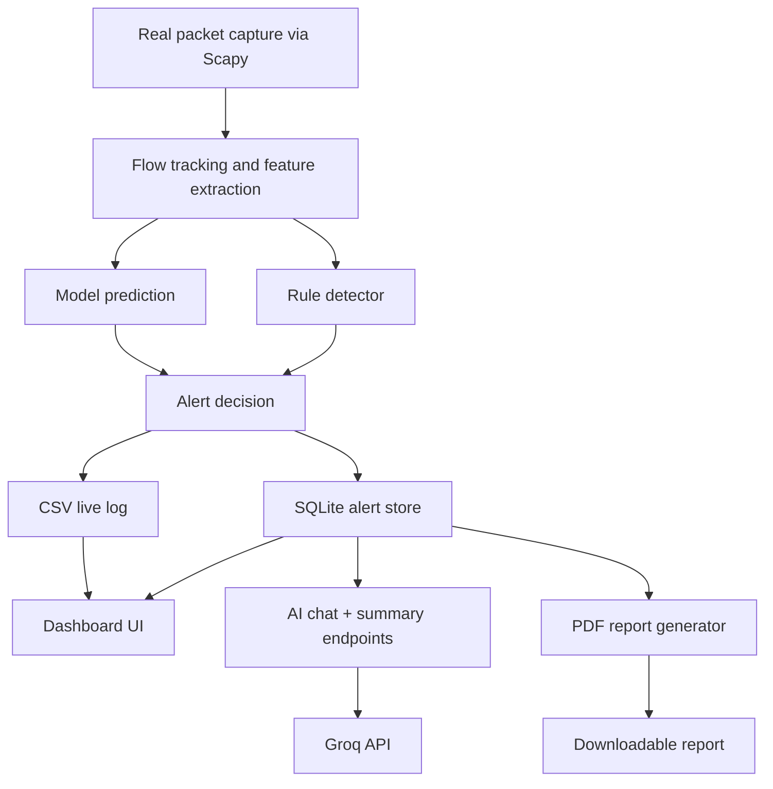

# SENTRY Project Guide

This document explains the project as it exists in the current workspace. It is based on the actual source code, configuration, templates, and dependencies found under the project root.

## 1. Project Overview

This project is a Python-based Security Operations Center (SOC) dashboard called SENTRY. Its main goal is to monitor live network traffic, detect suspicious activity, and present the results in a browser-based dashboard with AI-assisted explanations.

The application is built around a real network intrusion detection pipeline:

- Packet capture from a real network interface using Scapy
- Flow extraction from raw packets into network-flow features
- Machine-learning classification to label common attack types
- Unsupervised anomaly detection to catch unusual traffic patterns
- Rule-based detection for fast threats like port scans and SYN floods
- SQLite storage for alerts and chat history
- Flask dashboard for viewing live traffic and threats
- Groq API integration for AI analysis and summaries
- PDF report generation for incidents

The project is not just a static demo. It is designed to work against actual network traffic on a machine with the proper permissions and networking setup. The README explicitly states that Windows users may need Npcap and Administrator privileges for packet capture.

The app is organized as a lightweight full-stack Python app: backend logic in Python, frontend in Jinja templates + JavaScript + CSS, and machine learning in scikit-learn/XGBoost.

## 2. Features

The project includes the following major features:

### 2.1 Real-time packet capture
The app can start a live packet capture on a selected interface and inspect traffic in real time. This is implemented in [capture.py](./capture.py) and started via the Flask endpoint `/api/capture/start` in [app.py](./app.py).

### 2.2 Flow-based traffic analysis
Packets are grouped into flows based on direction-independent 5-tuple logic (source/destination IP, port, protocol). The project tracks packet and byte totals, inter-arrival times, TCP flags, and flow timing.

### 2.3 Supervised ML attack detection
The model in [model.py](./model.py) trains on CICIDS CSV datasets under the [data/](./data) directory. It uses XGBoost when available, otherwise falls back to scikit-learn GradientBoostingClassifier. The trained model labels traffic as categories such as Normal, DDoS, DoS, PortScan, WebAttack, BruteForce, Bot, and Infiltration.

### 2.4 Unsupervised anomaly detection
A second layer uses Isolation Forest to detect unusual network behavior even when the model does not explicitly classify the flow as malicious. This is based on anomaly score thresholds.

### 2.5 Rule-based detections
The file [rules.py](./rules.py) adds logic for fast, deterministic detections such as:

- Port scanning across many destination ports
- SYN floods toward one target port
- Repeated attack patterns that are filtered to avoid spammy alerts

These rules are separate from ML predictions and can override or complement model output.

### 2.6 Live SOC dashboard
The dashboard UI is defined by templates under [templates/](./templates) and styled by [static/css/style.css](./static/css/style.css). It shows:

- Live flow counts
- Flagged events
- Uptime
- Active scan radar visualization
- Recent anomalies

### 2.7 AI chat for alerts and general SOC questions
The app uses Groq API integration via [llm_chat.py](./llm_chat.py). It supports:

- Questions about a specific alert
- General security questions
- Session summaries
- Incident narrative generation

### 2.8 PDF report generation
[report_pdf.py](./report_pdf.py) builds a styled PDF report of the session, including totals, category breakdowns, risk summaries, and alerts. The report is downloadable from the web UI.

### 2.9 Local SQLite alert storage
[storage.py](./storage.py) stores alerts and per-alert chat messages in a local SQLite database file [data/sentry.db](./data/sentry.db). This enables persistent alert history between loads.

### 2.10 Live CSV logging
[live_log.py](./live_log.py) writes analyzed flow records to [data_out/live_captured.csv](./data_out/live_captured.csv), preserving a recent log of flows and detections in CSV format.

## 3. Project Structure

At a high level, the project is structured like this:

```text
soc_copilot_v2/
├── app.py                     # Flask web app / app entrypoint
├── capture.py                 # Live packet capture and flow extraction
├── live_log.py                # Recent flow CSV logger
├── model.py                   # ML training and prediction
├── llm_chat.py                # Groq AI integration
├── rules.py                   # Rule-based detections
├── storage.py                 # SQLite alert storage
├── report_pdf.py              # PDF report generator
├── README.md                  # Project setup overview
├── requirements.txt           # Python dependencies
├── static/
│   ├── css/style.css         # Theme and dashboard styles
│   └── js/
│       ├── chat.js           # Alert chat front-end logic
│       ├── dashboard.js      # Dashboard polling and controls
│       ├── markdown.js       # Markdown formatter for AI responses
│       └── report.js         # Report generation UI logic
├── templates/
│   ├── about.html            # About page
│   ├── ai.html               # AI chat and alert history page
│   ├── base.html             # Shared layout / sidebar
│   ├── chat.html             # Per-alert chat page
│   ├── dashboard.html        # Live feed dashboard page
│   ├── model_eval.html       # Model evaluation page
│   └── report.html           # Report page
├── data/
│   ├── sentry.db            # SQLite database for alerts/history
│   ├── model.pkl            # Serialized trained model
│   ├── CICIDS2017/          # CSV datasets for training
│   └── CICIDS2018/          # Parquet datasets for training
├── data_out/
│   └── live_captured.csv     # Recent flow log output
├── venv/                     # Local Python virtual environment
├── .env                      # Expected config file for API keys (not shown here)
└── PROJECT_GUIDE.md           # This guide
```

## 4. File-by-File Explanation

### [README.md](./README.md)
This is the highest-level project intro. It explains the purpose of the application and the basic setup procedure. It states that the app is a "SOC Copilot" doing real-packet capture, flow feature extraction, XGBoost classification, Isolation Forest anomaly detection, and Groq AI chat/reporting.

### [requirements.txt](./requirements.txt)
Lists Python packages needed by the application:

- Flask
- NumPy
- pandas
- scikit-learn
- xgboost
- scapy
- python-dotenv
- fpdf2
- requests

These dependencies support the web server, ML pipeline, packet capture, PDF generation, and AI integration.

### [app.py](./app.py)
This is the main Flask application file. It defines the routes, creates global objects such as the model and detector, manages live capture state, and orchestrates the alert pipeline. It also acts as the central controller that ties together:

- Live packet flow collection
- Model prediction
- Rule firing
- Logging
- Alerts
- AI chat endpoints
- PDF/summary reports

### [capture.py](./capture.py)
This file implements the low-level packet capture and flow summarization logic. It:

- detects network interfaces
- creates flow keys for bidirectional traffic
- tracks packet counts, byte counts, IAT stats, and TCP flags
- closes dormant flows after a timeout
- calls the prediction pipeline when a flow is complete

The logic is more detailed than a simple packet sniffer: it converts network traffic into CICFlowMeter-style features.

### [live_log.py](./live_log.py)
This logger writes recent flow records to CSV. It maintains an in-memory deque for the dashboard and writes each event to disk. It is intentionally lightweight and focused on recent analysis.

### [model.py](./model.py)
This is the most important ML piece of the project. It:

- scans the [data/](./data) directory for CSV files
- fingerprints the dataset to detect changes
- loads prior serialized model state if the dataset is unchanged
- otherwise trains a fresh XGBoost/GradientBoosting classifier and Isolation Forest
- saves the trained models to [data/model.pkl](./data/model.pkl)
- predicts whether a flow is attack or normal
- returns confidence, anomaly score, and top features

This file documents a practical self-healing design: if the dataset changes, the app retrains automatically rather than silently using stale models.

### [rules.py](./rules.py)
This file implements behavior-based detection without relying on the ML model. It monitors:

- scan windows: many distinct target ports on one source/destination pair
- SYN flood windows: many SYN flows to the same destination port

It uses a cooldown to reduce noise and avoid repeated alerts for the same behavior.

### [llm_chat.py](./llm_chat.py)
This file abstracts the Groq API. It:

- loads the environment key from `.env`
- supports general AI chat, alert-specific explanations, and session summaries
- handles model fallbacks to different Groq models
- converts tool errors into a custom `LLMError`

It is intentionally designed to fail gracefully rather than silently save broken chat responses.

### [storage.py](./storage.py)
This file controls the SQLite database schema for:

- alerts table
- chat thread history table

It serializes `top_features` JSON, stores boolean detection flags, and exposes methods to save and fetch alerts and messages.

### [report_pdf.py](./report_pdf.py)
This builds a PDF report using `fpdf2`. It creates a terminal-like report style with section titles, simple metrics, bar visuals, and alert tables. The report includes the stats and narrative generated by the app.

### [templates/](./templates)
The project uses Flask Jinja templates, each corresponding to a page:

- [templates/base.html](./templates/base.html): common site layout and sidebar
- [templates/dashboard.html](./templates/dashboard.html): live feed dashboard
- [templates/ai.html](./templates/ai.html): AI chat and alert list
- [templates/chat.html](./templates/chat.html): alert-specific conversation page
- [templates/report.html](./templates/report.html): report view and PDF generation controls
- [templates/model_eval.html](./templates/model_eval.html): performance metrics and confusion matrix
- [templates/about.html](./templates/about.html): project explanation page

### [static/js/](./static/js)
These files implement front-end behavior such as:

- polling `/api/state`
- starting/stopping capture
- drawing the radar effect
- generating alert rows
- formatting markdown from AI responses
- loading alert dropdowns
- fetching reports

### [static/css/style.css](./static/css/style.css)
This file defines the color scheme, layout, dashboard panels, cards, buttons, and status indicators. It gives the app a dark-terminal/security-dashboard aesthetic.

### [data/](./data)
This directory contains:

- trained model artifacts
- SQLite database from the app
- dataset files from CICIDS2017 and CICIDS2018

The project depends on these datasets for model training and evaluation. The code treats data files as the trusted source for creating the classifier.

### [data_out/live_captured.csv](./data_out/live_captured.csv)
This is the log artifact written by the live logger. It contains recent flow records and can be opened as CSV for manual review.

## 5. Architecture and Workflow

The project uses a simple but effective layered architecture.



### Main workflow

1. A user selects an interface in the dashboard.
2. `FlowSniffer` starts listening with Scapy.
3. Each packet is inspected and grouped into bidirectional flows.
4. Flow features such as packet counts, duration, IAT stats, bytes, and TCP flags are computed.
5. The app applies rule-based detection and machine learning prediction.
6. A decision is made: attack, anomaly, or normal.
7. Matching alerts are stored in SQLite and written to the live CSV.
8. The dashboard polls the server and updates the UI.
9. If the user asks the AI for insight, the app sends the alert or session context to Groq.
10. Reports can be generated as a summary or as a PDF.

## 6. Technologies Used

### Languages
- Python
- HTML
- CSS
- JavaScript

### Web / application stack
- Flask
- Jinja2 templates
- SQLite
- REST-style endpoints

### Data science / ML
- NumPy
- pandas
- scikit-learn
- XGBoost
- Isolation Forest
- LabelEncoder
- StandardScaler

### Network capture
- Scapy

### AI and reporting
- Groq API via `requests`
- `fpdf2` for PDF generation

### Environment / config
- `python-dotenv`
- `.env` file for secrets like API keys

## 7. Frontend Explanation

The frontend is intentionally lightweight and designed for a single-page SOC dashboard feel.

### Shared layout
[templates/base.html](./templates/base.html) establishes the sidebar navigation and a dark-themed dashboard shell. It also includes the status indicator that checks `/api/status` in the browser.

### Dashboard page
[templates/dashboard.html](./templates/dashboard.html) renders:

- interface selector
- start/stop capture controls
- stats cards
- radar panel
- recent scan feed
- detected anomalies feed

The JavaScript file [static/js/dashboard.js](./static/js/dashboard.js) polls `/api/state` every 2 seconds, updates the UI, and manages the capture button behavior.

### AI page
[templates/ai.html](./templates/ai.html) shows:

- a general chat panel
- alert history
- links to per-alert chats

The browser logic in [static/js/chat.js](./static/js/chat.js) sends chat messages to `/api/chat/general` and formats markdown responses.

### Alert chat page
[templates/chat.html](./templates/chat.html) is a focused interface for one alert. The per-alert chat uses `/api/chat/<id>` and is meant for deeper investigation into a detected event.

### Report page
[templates/report.html](./templates/report.html) offers two modes:

- report for a single alert
- report for the full session

The page fetches data from `/api/report/alert/<id>` and `/api/report/summary` and renders it in the browser. The logic lives in [static/js/report.js](./static/js/report.js).

### Model evaluation page
[templates/model_eval.html](./templates/model_eval.html) displays train/test metrics, per-class metrics, and a confusion matrix. It is a direct view of the evaluation data stored in the model object.

### Styling
[static/css/style.css](./static/css/style.css) uses a dark terminal aesthetic with orange highlights and a SOC/security dashboard feel. It is a custom CSS layer rather than a UI framework.

## 8. Backend Explanation

The backend is the core of the application. It is driven by Flask routes in [app.py](./app.py).

### Route groups

#### Page routes
- `/` -> dashboard
- `/ai` -> AI page
- `/chat/<aid>` -> alert-specific chat page
- `/report` -> reports dashboard
- `/model-eval` -> model evaluation page
- `/about` -> project info page

#### Capture routes
- `/api/interfaces` -> list available interfaces
- `/api/capture/start` -> start sniffing
- `/api/capture/stop` -> stop sniffing
- `/api/status` -> current capture state
- `/api/state` -> overall stats and activity snapshot

#### Chat routes
- `/api/chat/<int:aid>` -> chat about one alert
- `/api/chat/general` -> general SOC chat
- `/api/chat/general/clear` -> clear general chat

#### Report routes
- `/api/report/summary` -> full session summary
- `/api/report/alert/<int:aid>` -> narrative for one alert
- `/api/report/pdf` -> download PDF report

#### History management
- `/api/history/clear` -> reset stored alerts + log data

### Business logic server-side
The backend does several key things:

- manages the `FlowSniffer` instance
- validates capture requests
- decides whether a flow is an attack or anomaly
- stores alert metadata in SQLite
- invokes Groq summary functions when asked
- sends reports back to the browser as JSON or PDF

### Database interactions
[storage.py](./storage.py) abstracts the database so the app does not interact with raw SQL everywhere. The app stores:

- alert metadata
- severity / confidence / source/destination fields
- boolean flags for attack / anomaly detection
- top features JSON
- chat messages attached to each alert

## 9. Configuration and Environment

### Dependencies
The project expects Python dependencies from [requirements.txt](./requirements.txt). These are installed with `pip install -r requirements.txt`.

### Environment variables
The app expects a `.env` file with keys such as:

- `GROQ_API_KEY` for alert/general chat
- `GROQ_REPORT_API_KEY` for report narratives (optional; it falls back to `GROQ_API_KEY` if not set)

The app loads this environment file using `python-dotenv` in [llm_chat.py](./llm_chat.py).

Important security note: I did not include or reveal any actual secrets from the workspace. The guidance here is intentionally generic.

### Runtime requirements
The README and code indicate that Windows users typically need:

- Npcap installed
- terminal run as Administrator
- a real network interface available for packet capture

### Artifacts created at runtime
The app creates or updates:

- [data/model.pkl](./data/model.pkl) when model training runs
- [data/sentry.db](./data/sentry.db) when alerts are stored
- [data_out/live_captured.csv](./data_out/live_captured.csv) when flows are logged

## 10. How to Install and Run

### Prerequisites
- Python 3.11+ is likely appropriate; the project includes a local venv folder and package versions that are modern enough for this environment.
- On Windows: install Npcap for packet capture.
- Run the terminal with Administrator privileges if you want to capture live traffic.

### Install steps

```powershell
cd C:\Users\achua\Downloads\soc_copilot_v2
python -m venv venv
.\venv\Scripts\Activate.ps1
pip install -r requirements.txt
```

Create a `.env` file in the project root with at least:

```env
GROQ_API_KEY=your_key_here
```

Optional:

```env
GROQ_REPORT_API_KEY=your_report_key_here
```

### Run the app

```powershell
python app.py
```

Then open in the browser:

```text
http://127.0.0.1:5000
```

### First run behavior
On the first startup, the app tries to train or load the model. If datasets are present under [data/](./data), the model trains automatically and saves itself to [data/model.pkl](./data/model.pkl). If no compatible CSVs are present, the app disables detection and warns the user that it needs a dataset.

## 11. Important Code Flows

### 11.1 Flow capture and classification
This is the main runtime loop:

1. The user clicks Start Capture.
2. [app.py](./app.py) calls `FlowSniffer.start()`.
3. The sniffer receives packets in `_on_packet()`.
4. Packets are grouped into flows and feature dictionaries are built.
5. A flow is closed after inactivity and passed to `compute_flow_features()`.
6. `process_flow()` runs on the flow.
7. The model predicts label + confidence.
8. Rule detection may override or augment the decision.
9. The flow is logged and alert is stored if necessary.

### 11.2 Model training and persistence
The model is trained only when needed:

- `SOCModel.__init__()` calls `load_or_train()`
- `_scan_csvs()` looks for CSVs under [data/](./data)
- `_fingerprint()` hashes the dataset file metadata
- if the model file exists and the fingerprint matches, it is loaded
- otherwise, the dataset is processed and a new model is trained and serialized

This protects against stale model reuse.

### 11.3 AI alert chat flow
When a user sends a chat message:

1. The route in [app.py](./app.py) loads the relevant alert from SQLite
2. It fetches the per-alert chat history
3. It calls `llm_chat.chat_about_alert()`
4. The model prompt is built from alert context and prior chat history
5. Groq returns a reply
6. The reply is stored in the database

### 11.4 Session summary flow
The report page calls `/api/report/summary`, which:

- reads alert history
- groups results by label
- calculates top source IPs
- invokes `llm_chat.summarize_session(stats)`
- returns a narrative to the browser

## 12. Testing and Debugging

### What exists
This project does not appear to contain a formal automated test suite. The code is primarily structured as a running application and does not include unit tests or pytest files in the visible workspace.

### What was validated here
I validated the core Python files by compiling them with Python syntax checking using `py_compile`. This confirms that the major Python files can be parsed successfully.

### Debugging signs and common issues
The code includes several practical patterns for debugging and resilience:

- `print()` statements around model loading and training
- `try/except` blocks around Groq API failures
- attempts to avoid catastrophic issues when the dataset is missing or malformed
- queue-based processing to decouple packet sniffing from model work
- error handling under the flow worker thread

### Typical problems to watch for
- No `GROQ_API_KEY` configured -> AI features fail with `LLMError`
- No dataset under [data/](./data) -> model is disabled
- No Npcap / no admin rights -> live packet capture fails
- Interface selection mismatch -> `FlowSniffer.start()` raises a runtime error if the chosen IP is not present
- Queue overflow or dropped flows -> this is explicitly tracked in the backend with `dropped_flows`

### Logs and artifacts
Useful places to inspect when debugging:

- terminal output from `python app.py`
- [data_out/live_captured.csv](./data_out/live_captured.csv)
- [data/sentry.db](./data/sentry.db)
- model training output in the console

## 13. Dependencies and Integrations

### Core dependencies
The project depends on these packages heavily:

- Flask: web framework
- Scapy: packet capture and parsing
- pandas / NumPy: data preparation and analysis
- scikit-learn: machine learning and evaluation
- XGBoost: high-performance classifier
- FPDF2: report generation
- requests: calling Groq API
- python-dotenv: environment configuration

### External services
- Groq API for AI chat and summaries
- Network interface (real NIC / wired/wireless adapter)
- Dataset files from CICIDS2017 and CICIDS2018 as training inputs

### Local storage
- SQLite database file [data/sentry.db](./data/sentry.db)
- CSV output at [data_out/live_captured.csv](./data_out/live_captured.csv)
- Serialized model at [data/model.pkl](./data/model.pkl)

## 14. Learning Guide

This is a beginner-friendly path to understanding the project.

### Step 1: Start with the entrypoint
Read [app.py](./app.py) first. It shows the actual runtime flow and the route definitions. It answers: "What is the web app doing, and how does it connect all the pieces?"

### Step 2: Understand the capture pipeline
Read [capture.py](./capture.py). This is where packet capture and flow extraction happen. Focus on:

- `FlowSniffer._on_packet()`
- `compute_flow_features()`
- `FlowSniffer._reaper()`

These functions show how raw packets become model-ready flow features.

### Step 3: Learn the model
Read [model.py](./model.py). Study:

- `_load_one_csv()` and dataset loading
- `load_real_datasets()`
- `SOCModel.load_or_train()`
- `SOCModel.predict()`

This explains how the project turns network records into attack labels and anomaly scores.

### Step 4: Read the rule detector
Read [rules.py](./rules.py). It is a simpler, more interpretable logic layer. It explains how the app catches suspicious patterns without waiting for ML output.

### Step 5: Understand storage and history
Read [storage.py](./storage.py). It shows how alerts and chat data are kept in SQLite. This is crucial to understanding persistence and the UI.

### Step 6: Read the frontend pages and JS
Open the templates and scripts under [templates/](./templates) and [static/js/](./static/js). The UI is intentionally simple and mirrors the backend route design closely.

### Step 7: Understand AI integration
Read [llm_chat.py](./llm_chat.py). It shows how the app integrates with Groq and builds prompts. This is the best place to modify or extend the assistant behavior.

### Step 8: Practice with a small dataset and manual observation
Try turning on capture in a controlled environment and watch the dashboard. Then compare the alert outputs to the actual packet characteristics. That will help connect the math and code to real-world network behavior.

## 15. Potential Issues and Improvements

The following observations are based on the code itself and are reasonable technical concerns rather than speculation.

### 15.1 No strong automated test coverage
The project currently seems to rely on runtime behavior and manual verification rather than a formal unit/integration test suite. This makes it harder to catch regressions when changing the model or the UI.

### 15.2 Dependency on live network conditions
The app requires access to a real interface, proper permissions, and a usable adapter. In a VM or restricted environment, packet capture may fail or behave inconsistently.

### 15.3 Heavy runtime dependency on dataset quality
The model cannot train meaningfully unless the CSV files under [data/](./data) are compatible with the expected column names and labels. If the data differs from the expected CICIDS 2017/2018 pattern, the app prints warnings and disables detection.

### 15.4 Potential false positives and model drift
The project includes a confidence threshold (`MIN_ATTACK_CONFIDENCE`) and detection rules to reduce noise, but real-world traffic can still vary a lot from the training distribution. The code already acknowledges this with the set `MIN_ATTACK_CONFIDENCE` and anomaly gating.

### 15.5 Limited security/authentication
The dashboard and report generation do not appear to implement user-level authentication or authorization. This is acceptable for a local demo, but it would be a major improvement for any production deployment.

### 15.6 AI features depend on external API availability
The project is coupled to Groq API availability and the validity of the API key. If the key is missing or the service is unavailable, AI features fail gracefully but the app still runs.

### 15.7 Noise reduction could be improved
The rule detector uses cooldown logic and queue tracking, which is good, but the design could be extended with deduplication, severity levels, alert suppression windows, and richer grouping across related events.

### 15.8 Better configuration management would help
The project is a good prototype but could benefit from explicit config files for default ports, capture timeout settings, and model thresholds, rather than embedding many values directly in source code.

## Files Not Inspected or Only Partially Reviewed

These files were not meaningfully used as source documentation for this guide because they are either generated artifacts, third-party package code, or very large data files:

- The virtual environment under [venv/](./venv) was not reviewed as project source logic; it contains installed libraries and third-party package code.
- The large dataset files under [data/CICIDS2017/](./data/CICIDS2017) and [data/CICIDS2018/](./data/CICIDS2018) were not fully inspected as raw data because they are large training assets, not application code.
- The serialized model file [data/model.pkl](./data/model.pkl) was not manually reverse-engineered; it is treated as a generated runtime artifact.
- The SQLite file [data/sentry.db](./data/sentry.db) was not manually read as a code source; it is application data.

This is intentional: the document focuses on the code that defines behavior, not the generated or vendor files that support execution.

## Summary

SENTRY is a Flask-based SOC dashboard that captures live network traffic, converts it into flow features, detects attacks with machine learning and rules, stores findings in SQLite, and lets users ask AI questions about alerts and incidents. The system is modular, practical, and designed to be understandable as a learning project.

The most important files to read first are:

- [app.py](./app.py)
- [capture.py](./capture.py)
- [model.py](./model.py)
- [rules.py](./rules.py)
- [llm_chat.py](./llm_chat.py)
- [storage.py](./storage.py)

From there, the templates and JavaScript give the full end-to-end picture of how the dashboard and analytics are presented to the user.
